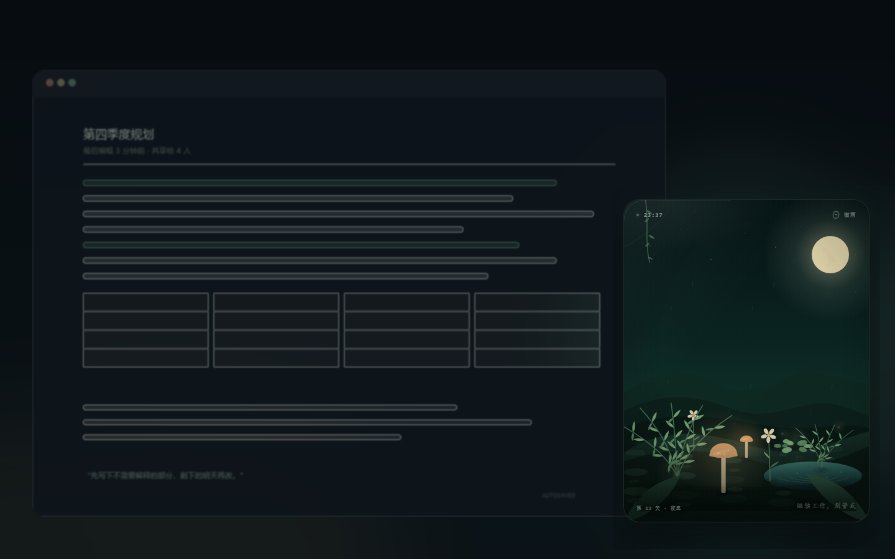
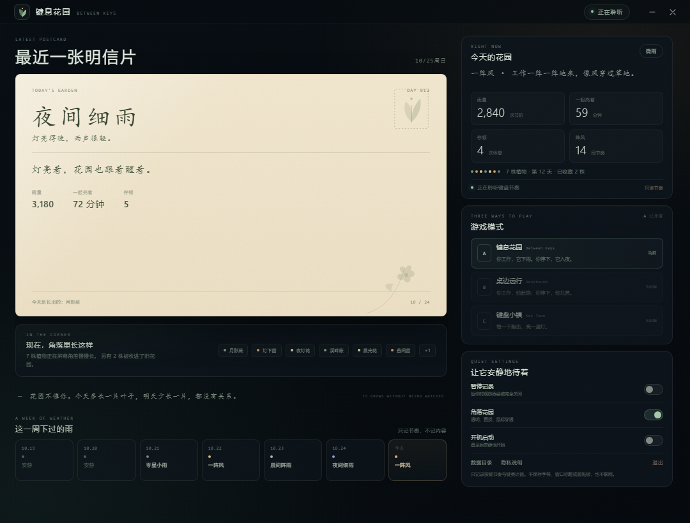

# 键息花园 · Keygarden

> 你工作，它下雨。你停下，它入夜。

一个活在桌面角落的安静小游戏：**正常打字，它就会慢慢生长**。不用记按键、不用切换窗口、也不用改工作习惯。



> 截图使用演示数据。悬浮窗是透明、置顶、鼠标穿透的；实际运行时它只占屏幕右下角一小块。
>
> 体验流程与下一版改版提案（PPT）：[keygarden-A-flow.pptx](docs/keygarden-A-flow.pptx)

## 现在是什么状态

**Mode A · 键息花园** 已实现并可运行。  
**Mode B · 桌边远行**、**Mode C · 键盘小镇** 已进入游戏模式选择器，显示为 `SOON`，后续可以复用同一套输入与节奏引擎继续做。

B/C 的完整概念图：[B 桌边远行](concepts/b.jpg) · [C 键盘小镇](concepts/c.jpg)

当前版本是一个 Windows x64 桌面原型，重点是验证：

1. 正常工作时的键盘节奏，能否驱动一个好玩、但不打扰人的小世界；
2. 全局键盘观察能否做到“只理解节奏，不理解内容”；
3. 一天结束时的一张明信片，是否足够成为回来的理由。

## 它会怎么玩

- **工作的时候**：右下角生态瓶里的天气会变化。连续输入起风、下雨；停顿久了，进入夜晚，萤火虫和蜗牛出来；退格键被理解为修剪，不是犯错。
- **按键类别**决定长什么：字母养蕨类，数字养蘑菇，标点养花，空格和回车让苔藓蔓延。
- **一天结束**：会有一张“今日花园”明信片，记录今天的雨型、一起亮着的时间、停顿次数，以及新长出的植物。
- **几周之后**：花园会留下不同工作节奏形成的物种变种，像一本只有你自己能读懂的天气年鉴。
- **没有失败**：植物不会因为你开会、请假或忘记打开而枯死。休息是夜间模式，不是惩罚。



## 功能

- 透明、置顶、鼠标穿透的桌面悬浮窗，不抢焦点
- 全局键盘节奏采集（只读键类与时间，不读字符）
- 天气、昼夜、植物生长、萤火虫、蜗牛、雨水与池塘动画
- 每日总结与明信片，保留最近 90 天
- 系统托盘：打开手帐、显示/隐藏花园、暂停、开机启动、退出
- 全局快捷键
- 本地 JSON 存档，无网络
- 游戏模式选择器：A 已开放，B/C 预留
- 自动锁屏/休眠暂停观察器
- 单元测试覆盖节奏分类、日切、成长、明信片、上限

## 快速开始

### 环境

- Windows 10/11 x64
- Node.js 20+
- 构建键盘观察器需要 .NET Framework 4.x（Windows 10/11 通常自带）

### 开发运行

```powershell
npm install
npm run build:helper
npm start
```

如果 PowerShell 执行策略拦截脚本，使用：

```powershell
npm run start:win
```

第一次启动会打开花园手帐。点“把它放到角落”之后，手帐会收起，右下角的透明花园开始工作。

### 安装到用户目录

```powershell
npm run package
npm run install:local
```

这会把可运行的便携版复制到：

```text
%LOCALAPPDATA%\Programs\Keygarden
```

并在桌面创建 `Keygarden.lnk`。应用数据保存在 `%APPDATA%\Keygarden`，升级程序不会覆盖你的花园。

> 便携包大约 347 MB，主要来自 Electron 运行时。仓库不提交构建产物。

## 快捷键

| 快捷键 | 作用 |
|---|---|
| `Ctrl+Alt+G` | 打开花园手帐 |
| `Ctrl+Alt+H` | 显示 / 隐藏角落花园 |
| `Ctrl+Alt+Space` | 暂停 / 继续记录 |

所有快捷键都可以先通过托盘使用；如果注册失败，手帐里会显示观察器状态。

## 隐私

**只记录节奏和键类，不记录内容。**

- 观察器 `KeygardenKeys.exe` 只输出 `letter / digit / punct / space / enter / backspace` 类别与时间戳；
- 不保存字符、按键序列、窗口标题、剪贴板、屏幕内容；
- 不联网，无遥测；
- 暂停时观察器进程会被结束，锁屏/休眠自动暂停；
- 原始时间戳只在内存中保留最近十几秒用于天气，不落盘。

完整说明见 [PRIVACY.md](PRIVACY.md)。输入密码、银行信息等敏感内容前，请按 `Ctrl+Alt+Space` 暂停，或从托盘退出。

## 技术结构

```text
KeygardenKeys.exe (C#)
  │  只发送 category + timestamp
  ▼
Electron main process
  ├─ KeyObserver       管理观察器进程、掉线重启、暂停
  ├─ GameEngine        节奏分类、植物成长、日切、明信片
  ├─ StateStore        本地 JSON 原子写入
  ├─ Overlay window    透明置顶、鼠标穿透、Canvas 动画
  └─ Journal window    手帐 / 明信片 / 模式选择 / 设置
```

主要目录：

```text
src/
  main/
    main.js           Electron 主进程与窗口、托盘、快捷键、IPC
    observer.js       全局观察器子进程管理
    engine.js         游戏状态、成长与每日结算
    store.js          本地存档
    demo.js           仅演示/截图使用的演示状态
  input/
    KeygardenKeys.cs  全局键类观察器源码
  preload/            contextBridge API
  renderer/
    overlay/          角落花园 UI + Canvas
    journal/          花园手帐 UI
  shared/
    modes.js          A / B / C 三种游戏模式元数据
    rhythm.js         节奏分类、物种、明信片文本
resources/
  KeygardenKeys.exe   已编译的观察器（x64）
  icon.png / icon.ico
tests/
concepts/             早期 A/B/C 概念图
docs/screenshots/     README 截图
```

### 为什么用单独的观察器进程

Electron 主进程直接装全局键盘钩子，在部分受限的 Windows 环境里不稳定。这里用独立的 C# 子进程读取键状态，并通过标准输出发送**键类**，主进程完全接触不到按键代码。副作用是隐私边界更清楚，暂停时也能直接结束这个进程。

## 测试

```powershell
npm test
```

当前覆盖：

- 节奏分类（晨间、夜间、持续、阵风、安静）
- 键类到植物的映射
- 日切、成长、新植物、明信片
- 明信片已读状态
- 9 株植物上限与归档
- 无输入日不生成明信片
- 跨多日未打开时的天数计算
- 旧存档归一化

## 已知限制

- **仅 Windows x64**，观察器和打包方式都针对 Windows；
- **未签名**：首次运行或安装时 Windows/杀毒软件可能提示；
- 全局观察器**无法识别密码框**，敏感输入请手动暂停；
- 以管理员权限运行的窗口可能不在观察范围内；
- B/C 模式目前只有入口和概念，没有实现；
- 这是一个早期的 A 模式原型，存档结构以后可能迁移。

### 在受限开发环境里运行

如果项目目录本身带有 Windows 的低完整性标签（例如某些自动化代理的 workspace），那么从该目录直接启动的进程可能无法读取全局键盘输入。此时：

```powershell
npm run package
npm run install:local
```

安装到 `%LOCALAPPDATA%\Programs\Keygarden` 再启动，就能在正常的用户完整性下运行。应用的键盘采集已在安装后的打包版本中验证：输入一组字母、数字、标点、空格和回车后，手帐正确记录了对应的类别计数。

## 路线图

- [x] A 模式最小可玩版本
- [x] 全局键类观察 + 隐私边界
- [x] 每日明信片与植物图鉴
- [x] B/C 模式选择器（占位）
- [ ] 手帐内的“今晚浇一次水 / 选一颗明日种子”
- [ ] B 模式：底部旅行风景带
- [ ] C 模式：等距小镇与每日蓝图
- [ ] 自动更新与签名安装包
- [ ] 更多物种变种与年度花园册

## 仓库

<https://github.com/Auoh/keygarden>

当前未选择开源许可证；如要公开发布，请先补上 LICENSE。
