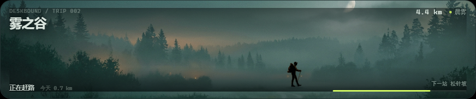

# Mode B · 桌边远行

**状态：可运行 MVP。** 不是概念图了，已经从手帐切换到 B，右下角会换成一条桌面底部的旅行风景带。

## 玩法

- 你正常打字，旅行者沿路往前赶
- 每个键增加约 2.2 米；标点走得快一点，数字和空格慢一点
- 连续工作是一段路；停下超过 5 分钟，他会扎营、生火
- 雨、风、雾、星夜由输入节奏和当前时间生成
- 走完 6km 到达下一段路，拾到一件纪念品
- 每天结束会生成一张旅行明信片，记录当天路程、节奏和纪念品

路线：

`雾之谷 → 松针坡 → 旧车站 → 风蚀原 → 星见湖 → 北岸`

## 界面

- 悬浮窗：底部居中的 `960×200` 风景带，窗口 `1000×240`
- 透明、无投影、默认桌面层、鼠标穿透；支持可选的**窗口置顶**
- 和 A 一样：鼠标移上去亮边，按住可直接拖到屏幕任意位置；A/B 位置独立保存
- 如果被其他窗口遮住，用手帐右上角“移动窗口”/托盘“移动窗口（20 秒）”临时置顶后再拖
- 手帐里的 **Mode B / DESKBOUND** 面板显示今日路程、总路程、纪念品和最近一张旅行明信片
- 手帐面板上的按钮可以直接在 A / B 之间切换
- 原来的“游戏模式”卡片里，B 已从 `SOON` 改为 `可切换`
- 已接入 6 张 24:5 风景背景（原图 2.35:1，按场景焦点裁切）、旅人 `walk.png` 和营地 `camp.png` 透明贴图；提示词见 [journey-image-prompts.md](journey-image-prompts.md)，放置路径见 [assets/README.md](../src/renderer/journey/assets/README.md)
- 旅人现在有 5 个状态：两帧行走（`walk` / `walk-b`）、休息、到达、雨天、营地坐姿。状态按下面的规则切换，不是随机播放

| 状态 | 触发条件 | 表现 |
| --- | --- | --- |
| 行走 | 正在推进，且没有触发其他状态 | 两帧交替，身体轻微上下浮动 |
| 休息 | 连续 20 秒没有按键，但还没到 5 分钟扎营 | 停下、拄杖站定，不再做行走浮动 |
| 到达 | 当前路段进度 ≥ 90% | 到达姿势，提醒下一段就在前面 |
| 雨天 | 当前天气是 `rain` | 换成长外套的雨天行走帧 |
| 扎营 | 停下超过 5 分钟 / 自动暂停 / 手动暂停 | 帐篷、篝火和坐在木头上的人一起出现 |

这些状态都按“有图就用、缺图就退回上一状态或代码绘制”的规则加载；替换同名 PNG 即可，不需要改代码。

## 代码

- `src/main/journey.js` — B 的独立状态机：路程、路段、天气、扎营、纪念品、日切、明信片
- `src/renderer/journey/` — 底部风景带 Canvas + HUD
- `src/main/main.js` — 按模式切换悬浮窗尺寸与页面
- `src/main/engine.js` — 同一套按键同时喂给 A 与 B，切换模式不丢进度
- `src/renderer/journal/` — B 状态面板与模式切换按钮

## 当前是 MVP，还缺什么

- B 的独立旅行手帐/明信片全屏页
- 纪念品三选一（现在按路段自动拾取）
- 更完整的地标、遭遇和路线分支
- 背景/旅人/营地已经接入；后续替换时保持同名文件即可

这些不影响现在先跑通“工作 → 赶路 → 扎营 → 日切明信片”的主循环。
